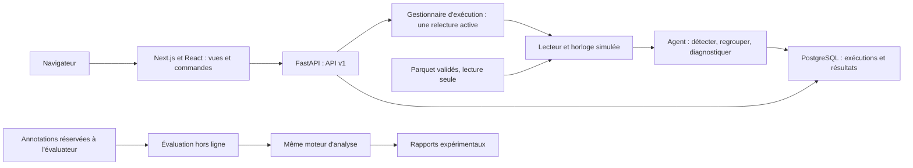

# SmartOps — Conception détaillée de la première version

Version 0.2 — 21 octobre 2026. Spécification cible ; seul le socle d'intégration est implémenté.

Ce document prolonge la [conception préliminaire](conception_preliminaire.md).
Les choix ci-dessous servent de référence pour la première chaîne fonctionnelle.
Les valeurs de détection sont des paramètres initiaux, pas des résultats validés.

## 1. Choix techniques

| Partie | Choix | Justification pour notre périmètre |
|---|---|---|
| Langages | Python côté analyse/API ; TypeScript côté frontend | Traitement scientifique et interface web dédiée ; versions compatibles figées à l'installation |
| Lecture et calcul | pandas, NumPy, PyArrow | Réutilisation des formats Parquet et de l'environnement d'audit |
| API | FastAPI et modèles Pydantic | Contrats typés, validation des requêtes et documentation OpenAPI |
| Interface | Next.js App Router, React et TypeScript | Navigation, composants interactifs et contrôle du rendu visuel |
| Style et composants | Tailwind CSS et shadcn/ui | Système visuel personnalisé, thèmes et composants accessibles |
| Graphiques | Apache ECharts | Séries temporelles interactives, zoom et vues comparatives |
| Synchronisation frontend | TanStack Query ; événements serveur SSE | Cache par exécution, chargement des données et actualisation après événement |
| Persistance | PostgreSQL, SQLAlchemy, Psycopg 3 et Alembic | Pilote de connexion explicite, transactions, JSONB et migrations versionnées |
| Tests | pytest et Playwright | Vérification du moteur, de l'API et des parcours dans le navigateur |
| Déploiement | Docker Compose | Frontend, backend, base de données, réseau et volumes |
| CI | GitHub Actions | Exécuter les vérifications sur de petits jeux de test synthétiques |

FastAPI documente la validation et la génération OpenAPI dans ses
[fonctionnalités officielles](https://fastapi.tiangolo.com/features/).
[Next.js](https://nextjs.org/docs/app) fournit le cadre React du frontend ;
[shadcn/ui](https://ui.shadcn.com/docs) fournit des composants personnalisables.
[ECharts](https://echarts.apache.org/en/feature.html) couvre les graphiques interactifs,
et [TanStack Query](https://tanstack.com/query/latest/docs/framework/react/overview)
gère l'état issu de l'API. PostgreSQL fournit le type
[JSONB](https://www.postgresql.org/docs/current/datatype-json.html) pour les preuves structurées,
et [Compose](https://docs.docker.com/compose/) décrit le lancement des conteneurs.
Le dimensionnement est notre décision de conception, pas une garantie donnée par ces outils.

L'interface web dédiée est un choix explicite du projet. Le rendu visé est celui
d'une console d'observabilité : hiérarchie typographique, navigation latérale,
chronologie, recherche de logs et détails d'incidents lisibles. Le framework seul
ne garantit pas ce rendu ; une conception visuelle spécifique sera réalisée.
Voir [la stratégie technologique et visuelle](strategie_technologique.md).

Les versions des nouvelles dépendances seront figées et vérifiées lors de la
création de l'environnement applicatif. `requirements-audit.txt` reste réservé à l'audit.

### Compatibilité : état de vérification

Les intégrations Next.js/Tailwind/shadcn et React/TanStack Query sont documentées
par leurs éditeurs. SQLAlchemy documente le pilote Psycopg 3 pour PostgreSQL,
avec des moteurs synchrones et asynchrones. Le pilote retenu est donc `psycopg`,
avec le dialecte explicite `postgresql+psycopg` ; SQLAlchemy seul ne fournit pas
une connexion complète à la base.

Les graphiques interactifs ECharts, le provider TanStack Query et EventSource
seront placés côté navigateur dans des composants React clients. ECharts sera
initialisé après montage, avec destruction de l'instance au démontage. Le rendu
serveur de Next.js ne doit pas exécuter du code supposant `window` ou un élément DOM.

La documentation Next.js consultée indique Node.js 20.9 au minimum ; le poste
dispose de Node.js 24.11.1. Cette condition est satisfaite, mais ne constitue pas
un test de build. À ce stade, aucun lockfile applicatif, build frontend, migration
PostgreSQL ou test SSE de bout en bout n'a encore été produit. La compatibilité
architecturale est documentée ; la combinaison exacte des versions reste à valider
par installation, résolution des dépendances, compilation et tests d'intégration.
La présence de la commande Docker ne prouve pas non plus que les services démarrent.
Ce paragraphe décrit l'état au moment du choix de stack. Le jalon d'intégration
suivant possède ses propres vérifications : consulter le
[guide d'exécution](demarrage.md) et le [rapport de validation](../reports/validation_socle.md).

Références : [installation Next.js](https://nextjs.org/docs/app/getting-started/installation),
[intégration shadcn/Next.js](https://ui.shadcn.com/docs/installation/next),
[installation TanStack Query](https://tanstack.com/query/latest/docs/framework/react/installation),
[Psycopg dans SQLAlchemy](https://docs.sqlalchemy.org/en/20/dialects/postgresql.html#psycopg).

## 2. Organisation de l'application

Trois services : un backend, un frontend et PostgreSQL. Un seul backend possède l'agent,
l'horloge simulée, la connexion aux fichiers et les écritures dans la base.
L'interface consomme l'API ; elle n'exécute pas une deuxième copie du détecteur
lorsqu'une page se rafraîchit.



Le backend tourne avec **un seul processus serveur** pour la première version.
Un gestionnaire unique sérialise les commandes et les pas de calcul. Il refuse le
démarrage d'une deuxième relecture tant qu'une exécution est en cours ou en pause.
Un calcul ne doit pas bloquer une requête de consultation : une tâche de travail
interne prend en charge le moteur. Ajouter plusieurs workers serveur nécessiterait
un ordonnanceur partagé ; ce n'est pas prévu dans cette version.

### Arborescence cible, à créer pendant l'implémentation

```text
src/smartops/
  domain/          objets de données et états
  ingestion/       adaptateur RCAEval et registre de scénarios
  replay/          horloge et lecture incrémentale
  detection/       référence robuste et persistance des anomalies
  incidents/       regroupement et cycle de suivi
  diagnosis/       collecte de preuves, classement et procédures
  storage/         modèles SQLAlchemy, dépôts PostgreSQL et migrations Alembic
  api/             routes, modèles publics et gestionnaire d'exécution
  evaluation/      accès aux annotations et calcul des résultats
frontend/          Next.js, TypeScript, Tailwind CSS, shadcn/ui et ECharts
tests/             tests Python unitaires et d'intégration
frontend/e2e/      parcours navigateur Playwright
```

## 3. Préparation, identifiants et temps

Un processus de préparation produit trois espaces distincts :

| Espace | Contenu | Accès |
|---|---|---|
| Brut | Fichiers téléchargés, manifestes et index original | Préparation et audit |
| Monitoring | Télémétrie validée dans des dossiers aux identifiants opaques, registre public | Backend et moteur |
| Évaluation | Correspondance des identifiants avec les cas, annotations et répétitions | Évaluateur seulement |

Un UUID est attribué à chaque scénario et conservé dans un registre de préparation
pour rester stable lors d'une nouvelle importation. Le nom public est neutre, par
exemple « Scénario 001 ». Les noms d'origine encodent la panne : ils ne sont ni
retournés par l'API ni transmis au diagnostic. Les index et fichiers d'injection
ne sont pas montés dans le conteneur du backend.

La préparation harmonise `frontendservice` et `frontend`, vérifie les timestamps
et produit un inventaire de la couverture. Elle n'apprend aucun seuil sur les données
de test et ne remplit pas les lacunes par des valeurs futures.

Convention interne : **timestamp Unix UTC en millisecondes**, entier `event_time_ms`.
Les métriques/logs sont convertis depuis les secondes. L'interface peut afficher une
date locale, sans changer l'ordre des observations. Les unités de métriques restent
`unknown` tant que leur provenance n'a pas été vérifiée ; pas d'étiquette « % » ou
« ms » déduite uniquement du nom d'une colonne.

Un pas traite toutes les observations dans `(curseur_précédent, nouveau_curseur]`.
Le premier pas inclut le début de l'enregistrement. Une preuve doit avoir un temps
de disponibilité inférieur ou égal au curseur. Pour les traces, il faut attendre
la fin du span et vérifier l'unité de durée ; le seul début du span ne suffit pas.

La relecture avance par pas de **1 seconde simulée**. La vitesse 10 signifie dix
secondes simulées par seconde réelle comme objectif de cadence. Si le calcul prend
plus de temps, la relecture ralentit sans sauter de données. Les fenêtres de calcul
utilisent le temps simulé, jamais la vitesse d'affichage. La pause conserve le curseur.

Le backend filtre aussi les courbes et logs retournés à l'interface à ce curseur.
Lire un fichier local en mémoire ne donne pas au moteur ou à l'interface l'accès
à ses observations futures.

## 4. Contrats des modules

| Module | Entrée | Sortie | Invariant |
|---|---|---|---|
| Adaptateur | Scénario préparé | Flux d'observations normalisées, inventaire et qualité | Aucun label de panne dans la sortie |
| Relecture | Flux, curseur et commande | Lot disponible, curseur confirmé | Ordre temporel et aucun événement sauté |
| Détecteur | Observations métriques du lot | Scores par métrique et couverture | Pas d'état conservé entre deux exécutions |
| Gestionnaire d'incidents | Scores, alertes et temps simulé | Incident nouveau ou actualisé | Réexécuter un même pas ne crée pas de doublon |
| Collecteur | Incident et fenêtre passée | Preuves référencées, disponibilité des signaux | Pas de preuve postérieure à l'analyse |
| Diagnostic | Preuves et version de règles | Suspects classés ou abstention, procédures proposées | Justification consultable pour chaque hypothèse |
| Stockage | Résultat d'un pas | Résultats et curseur persistés ensemble | Transaction atomique |
| Évaluateur | Sorties du moteur et références | Mesures et dénominateurs | Les références ne modifient pas le moteur |

Contrats Python envisagés : `read_until(t) -> ObservationBatch`,
`observe(batch) -> DetectionBatch`, `update_incidents(batch) -> list[IncidentUpdate]`,
`collect(incident, t) -> EvidenceBundle` et `diagnose(bundle) -> Diagnosis`.
Les types concrets seront définis dans `domain/`.

Une erreur de lecture des métriques arrête l'exécution avec un état `failed`.
Une indisponibilité des logs ou des traces produit un diagnostic dégradé et un
message de couverture ; elle n'est pas assimilée à une absence d'erreur applicative.

## 5. Référence de détection

La configuration proposée est dans
[monitoring.example.json](../config/monitoring.example.json).

### Initialisation

Pendant les **300 premières secondes** de chaque enregistrement, afficher
`initializing` et accumuler les observations réelles de chaque métrique. Cette durée
est fixe et ne provient pas de l'heure d'injection. Une métrique doit compter au
moins **120 valeurs observées** pour être utilisable. Les autres restent en état
`insufficient_data` ; l'initialisation n'est pas prolongée à partir du futur.

La première version fige cette référence pour la suite de l'exécution. Elle n'adapte
pas automatiquement la normale à une panne persistante. Ce protocole expérimental
suppose une phase initiale saine, cohérente avec les cas audités ; cette hypothèse
devrait être revue pour une intégration à un système réel.

La référence inclut les timestamps strictement inférieurs à `début + 300 000 ms`.
Un lot traversant cette frontière est séparé avant le calcul : les observations
de surveillance ne sont pas incorporées rétroactivement à l'initialisation.

### Score par métrique

Sur la référence, calculer la médiane `m` et `MAD = médiane(|x - m|)`.
Si `MAD > 0`, calculer `z = |x - m| / (1.4826 × MAD)`.
Si MAD est nul mais l'intervalle interquartile est positif, utiliser `IQR / 1.349`
comme échelle. Si les deux sont nuls, utiliser une règle explicite de changement
par rapport à une constante : `|x - m| > max(1e-9, |m| × 1e-6)`.
Ce dernier signal est nommé `constant_reference_changed`, sans score infini.

Une valeur est candidate si `z >= 6` ou si la règle de changement constant s'applique.
Ces constantes sont des valeurs de départ à comparer sur validation, notamment
pour les métriques à très faible variance. Aucun seuil de performance n'est revendiqué.

### Persistance et données absentes

Une métrique déclenche une alerte lorsque **5 secondes distinctes** au moins sont
anormales parmi les 10 dernières secondes simulées, avec au moins 5 secondes
observées. Plusieurs valeurs dans une même seconde comptent pour une seule seconde.
Une donnée absente ne compte ni comme anormale ni comme normale. La première version
ne complète pas les valeurs pour prendre une décision ; les courbes montrent les lacunes.

Chaque alerte contient la métrique, la référence, la valeur, le score ou la règle
de changement, la fenêtre et les preuves. Le nombre de métriques éligibles est
affiché afin de distinguer un système calme d'un système peu observé.

## 6. Incidents, diagnostic et recommandations

Les alertes concomitantes sont regroupées dans un incident d'exécution, y compris
si plusieurs services sont touchés. Tant que de nouvelles anomalies surviennent
dans les 60 secondes simulées suivant la dernière, elles actualisent cet incident.
Au-delà, le suivi passe à `quiet` ; une nouvelle anomalie ouvre un autre incident.
L'interface affiche « signal d'anomalie absent » et ne conclut pas à une réparation.
La fin du fichier marque un suivi `recording_ended`, distinct d'une résolution.
L'acquittement utilisateur est une information indépendante de cet état.

L'agent rassemble les observations des **120 dernières secondes**, bornées au début
du cas et au curseur courant. Un premier diagnostic est publié à l'ouverture, puis
actualisé au plus toutes les 10 secondes simulées tant que l'incident est actif.
Chaque version conserve son propre instant d'analyse et ses preuves.

Pour la première version du classement :

- `M` est le maximum, parmi les métriques éligibles du service, de
  `min(z / seuil, 2) / 2` ; un changement constant confirmé vaut 1.
- `L` est un signal de surcroît d'événements d'erreur :
  `clip((n_erreurs - n_attendues) / (n_attendues + 1), 0, 1)`.
  Le nombre attendu est dérivé de la fréquence observée pendant l'initialisation,
  ramenée à la durée disponible de la fenêtre. Les motifs reconnus sont des règles
  versionnées, examinées sur développement, et non le simple nombre de lignes de logs.
- Si les deux signaux sont exploitables, `S = 0.8 M + 0.2 L`.
  En l'absence de logs exploitables, le score est `M`, avec couverture dégradée.
  Un service sans métrique éligible reçoit un signal log distinct, et n'est pas
  comparé silencieusement aux scores combinés.

Le diagnostic sépare les scores combinés, métriques seules et logs seuls dans son
explication. Les poids et le seuil d'abstention seront sélectionnés sur validation.
Un candidat exige un signal réellement anormal ; on ne produit pas de cause sur
la seule présence d'une valeur de score non nulle. Les ex æquo restent visibles.

Un tel classement est une heuristique de suspicion, pas une démonstration causale.
Le résultat peut identifier le service sans conclure au mécanisme. Un diagnostic
sans preuve suffisante porte `insufficient_evidence`. Le score ne sera pas affiché
comme un pourcentage de confiance.

Une procédure corrective contient `id`, `version`, conditions d'applicabilité,
vérifications proposées et indices ayant motivé sa sélection. Une absence de
procédure correspondante est affichée explicitement. Aucune commande corrective
n'est exécutée. Le prototype traces sera comparé sur des cas identiques avant
d'être incorporé au classement principal.

## 7. Modèle de stockage

Les observations volumineuses restent en Parquet. PostgreSQL conserve les éléments
nécessaires à l'historique et aux rapports :

| Table | Champs principaux et contraintes |
|---|---|
| scenarios | `id` UUID primaire, `display_name`, `start_ms`, `end_ms`, `revision`, `coverage_json` ; référence à un dossier préparé opaque |
| runs | `id`, `scenario_id` FK, `status`, `phase`, `cursor_ms`, `config_json`, `config_hash`, `engine_version`, dates système, erreur éventuelle |
| incidents | `id`, `run_id` FK, `opened_ms`, `last_anomaly_ms`, `tracking_state`, `acknowledged_at` nullable |
| alerts | `id`, `run_id` FK, `incident_id` FK, `event_ms`, `service`, `metric`, `rule`, `value`, `reference_json`, `score` nullable ; clé de déduplication |
| diagnoses | `id`, `incident_id` FK, `analysis_ms`, `version`, `status`, `candidates_json`, `limitations_json` |
| evidence | `id`, `run_id` FK, `available_ms`, `signal_type`, `service`, `locator_json`, `excerpt_json` ; empreinte de la source |
| diagnosis_evidence | `diagnosis_id` FK, `evidence_id` FK, rôle de l'indice ; clé primaire composée |
| recommendations | `id`, `diagnosis_id` FK, `procedure_id`, `procedure_version`, `reason`, `checks_json` |
| operation_requests | `request_id` primaire, `operation`, `run_id` FK nullable, empreinte du contenu, résultat et code HTTP enregistrés ; idempotence des créations et commandes |
| run_events | `sequence` croissante, `run_id` FK, `event_type`, `cursor_ms`, `payload_json` ; événements SSE confirmés par transaction |

Les références de preuve utilisent les fichiers préparés et une position de ligne,
pas les chemins originaux. Les exports recopient les valeurs ou extraits nécessaires
pour rester lisibles sans exposer ces chemins. Les requêtes temporelles filtrent
`available_ms <= cursor_ms`.

Clé de déduplication d'une alerte : `(run_id, metric, event_ms, rule)`, conservée avec
l'alerte via le dépôt. Index sur `(run_id, opened_ms)`, `(incident_id, analysis_ms)`
et `(run_id, available_ms)`. Utiliser les types UUID, BIGINT pour les temps simulés,
TIMESTAMPTZ pour les dates système et JSONB pour les champs structurés. Les clés
étrangères et contraintes d'unicité sont définies dans les migrations Alembic.
Chaque requête ou tâche possède sa session SQLAlchemy ; une session n'est pas
partagée entre calcul et consultations concurrentes.
Chaque transaction enregistre les résultats d'un pas et son curseur confirmé.
Les événements à publier sont écrits dans cette même transaction, puis diffusés
après confirmation. Une lecture SSE ne doit pas conserver une transaction ouverte.
Une alerte et son incident doivent appartenir au même run ; le dépôt vérifie cette
contrainte dans la même transaction. Une opération répétée ne rejoue pas ses effets.

Après un redémarrage, une exécution `running` ou `paused` devient `interrupted`.
La première version conserve ses résultats et propose de créer une nouvelle
exécution ; elle ne prétend pas restaurer l'état statistique en mémoire. Un nouveau
run repart du début, avec une référence et des identifiants propres.

## 8. API et interface

Le [contrat de l'API v1](contrat_api_v1.md) précise les routes, les transitions et
les réponses. Le tableau de bord utilise uniquement ce contrat.

| Vue | Contenu et commandes |
|---|---|
| Surveillance | Liste neutre de scénarios, démarrage/pause/reprise/arrêt, vitesse, curseur, phase d'initialisation, couverture, courbes et incidents |
| Incident | Chronologie, métriques déclenchantes, preuves consultables, suspects classés, limites, recommandations, acquittement et export JSON |
| Évaluation | Dernier rapport importé de l'évaluateur, protocole, dénominateurs et comparaison des variantes ; aucune injection d'annotations dans le moteur |

Le frontend interroge l'API via TanStack Query. Un flux SSE annonce les changements
de curseur, d'incident et de diagnostic ; ces notifications déclenchent la relecture
des ressources concernées. Les clés de cache incluent le run et les filtres.
Lors d'un changement de run, les anciennes connexions sont fermées et leurs
résultats ne peuvent pas contaminer l'écran courant. Un polling borné prend le
relais si le flux est indisponible. SSE utilise le curseur de relecture et ne
transporte aucune observation future.

Le rafraîchissement des données consulte les résultats ; il n'avance pas l'horloge.
Fermer la page n'arrête donc pas l'agent. Toute commande attend une réponse du
backend, et l'interface affiche l'état confirmé, pas seulement le bouton cliqué.

## 9. Protocole expérimental détaillé

Conserver les répétitions 1/2/3 pour développement/validation/test, 30 cas chacune.
Les règles, poids et seuils sont versionnés après validation et avant mesure sur
test. Le jeu de test n'est pas utilisé pour choisir les paramètres.

- **Détection** : premier incident ouvert dans les 180 secondes suivant l'injection.
  Ce même horizon est observable dans les 90 cas. Rapporter aussi le comportement
  sur le reste des enregistrements, séparément. Le délai est mesuré depuis
  l'injection, dont on connaît la limite comme référence de symptômes.
- **Fausses alertes** : nombre d'incidents ouverts après initialisation et avant
  injection divisé par les heures de surveillance de cette période. Exclure
  l'initialisation du dénominateur et publier le temps observé.
- **Diagnostic sur incident connu** : l'évaluateur demande une analyse à
  `injection + 60 s`, sans transmettre la cause ni cet horaire de référence au
  moteur. Cette expérience ne mesure pas la capacité de détection.
- **Chaîne complète** : pour une détection dans l'horizon, lire le diagnostic
  60 secondes après la détection. Si l'enregistrement se termine avant, marquer
  le diagnostic censuré, le compter comme non-réussi dans le résultat principal
  et publier ce nombre. Les non-détections et abstentions comptent également
  comme non-réussites.
- **Classement** : Top-1 et Top-3 sur tous les cas prévus, avec une règle figée
  de départage déterministe pour les ex æquo, en conservant leur signalement.
- **Ablation** : exécuter les variantes sur les mêmes cas, au même instant et
  avec les mêmes budgets temporels. Une comparaison avec traces sur six cas
  reste exploratoire ; elle ne vaut pas évaluation complète sur 90 cas.

Un incident déjà ouvert avant injection reste une fausse alerte ; il ne devient
pas rétroactivement une bonne détection parce que l'injection survient ensuite.
Les alertes, ouvertures d'incident et changements de métrique sont conservés
pour comprendre les cas où ce regroupement masque un nouvel événement.

## 10. Déploiement et validation à implémenter

Compose décrira `frontend`, `backend` et `postgres`, reliés sur le réseau interne.
Le navigateur accédera à l'interface sur `127.0.0.1:3000`, et l'API de développement
sera accessible sur `127.0.0.1:18000` (port hôte choisi pour éviter un conflit local).
Le frontend utilisera un chemin API de même origine relayé vers le backend, y
compris pour SSE, sans cache ni buffering du flux. Le comportement du proxy sera
vérifié en intégration ; une connexion directe avec origines explicitement
configurées reste une possibilité de développement.
Le backend lira la télémétrie préparée depuis un montage en lecture seule ; un
volume PostgreSQL conservera la base et un autre les exports. L'interface n'aura pas de montage
du dataset ni de la base. Les ports sont des choix de configuration modifiables.

Les nouvelles versions stables compatibles seront verrouillées avec un lockfile
Python et un lockfile frontend. Les scripts d'audit restent reproductibles dans
leur environnement Python 3.11 existant ; leur fichier de dépendances ne devient
pas le verrou de la future application.

L'évaluation sera une commande hors ligne qui réutilise le moteur. Elle disposera
de ses annotations dans son propre contexte et exportera un rapport agrégé pour
la vue d'évaluation. Aucun appel à une API payante n'est requis pour la première version.

Vérifications nécessaires pendant l'implémentation :

1. Tester qu'une modification de données futures ne change pas les résultats déjà produits.
2. Tester les références constantes, métriques absentes et séries sans données suffisantes.
3. Vérifier qu'une pause fige le curseur, qu'une reprise conserve l'état et que les
   vitesses 1 et 10 produisent les mêmes résultats en temps simulé.
4. Vérifier la déduplication, les transitions invalides et le redémarrage interrompu.
5. Vérifier que les réponses et preuves ne contiennent aucun nom de cas ni annotation réservée.
6. Rejouer les trois scénarios CPU, mémoire et réseau et exporter leurs rapports.
7. Vérifier reconnexion SSE, isolation du cache entre runs, accessibilité clavier
   et parcours démarrage/pause/reprise dans Playwright.

Premier jalon de code : adaptateur et objets du domaine, relecture déterministe,
détecteur robuste, persistance d'un incident et routes minimales. Le diagnostic
enrichi et les trois vues complètes viennent après cette chaîne vérifiable.
