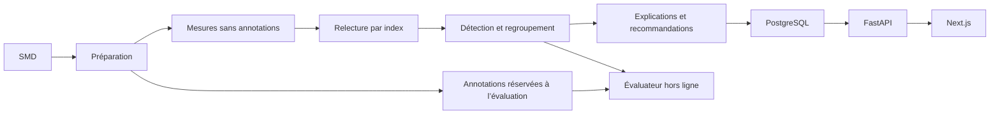

# Conception préliminaire — Supervision de machines avec SMD

## Objectif et périmètre

Observer CPU, charge, mémoire, disque et réseau ; détecter les comportements anormaux,
regrouper les alertes, expliquer les signaux suspects et recommander des vérifications.
SMD est le seul dataset retenu. La première version rejouera des observations enregistrées.
Elle ne prétendra pas surveiller une infrastructure en direct. Aucun log système ou trace
n’est fourni. Une explication n’est pas une preuve de cause physique ; aucune réparation automatique.

## Cas d’utilisation prévus

Sélectionner une machine ; examiner ses indicateurs normalisés ; lancer et suspendre
la relecture ; consulter alertes, preuves, explications et recommandations ; reproduire
une évaluation hors ligne sans divulguer les labels au détecteur.

## Architecture cible

## Évaluation et réalisation

Conserver `train` et `test` séparés par machine. Réserver une validation chronologique
sur `train`. Rapporter résultats par machine et globalement ; délais en observations.
Le socle, l’adaptateur SMD, la relecture par index et les vues par machine sont
implémentés. Le détecteur robuste et les alertes persistantes sont disponibles ;
les incidents, le diagnostic et les recommandations restent à implémenter.
