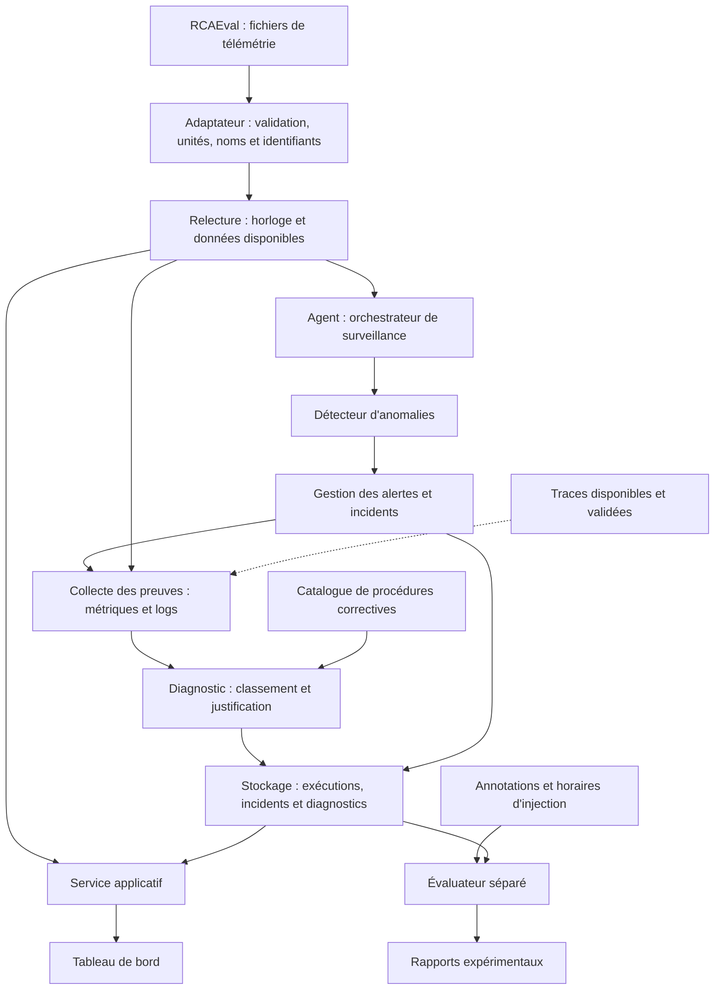
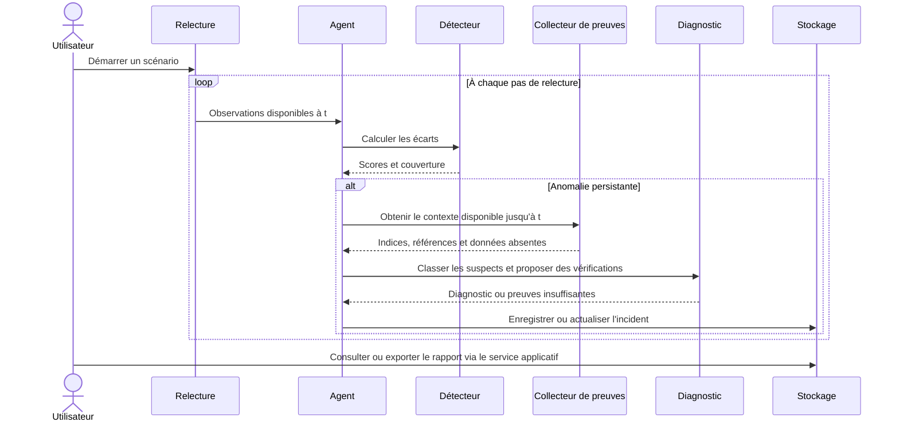

# SmartOps — Conception préliminaire

Version 0.1 — 21 octobre 2026. Document de conception, avant implémentation de l'application.

## 1. Contexte et problématique

Secteur : exploitation et infrastructure informatique.
Sujet : agent de monitoring intelligent.

Les métriques permettent de constater une dégradation, mais comprendre son origine
demande aussi d'examiner les logs et les échanges entre services. Le projet répond
à la question suivante : **comment détecter un comportement anormal d'une application,
rapprocher les signaux disponibles et proposer une cause probable expliquée ?**

Le support expérimental est RCAEval RE2-OB, déjà sélectionné et audité :
[étude du dataset](choix_dataset.md). Online Boutique est le système observé ; le
produit que nous développons est une application de surveillance et de diagnostic.

## 2. Objectifs et périmètre

La première version doit permettre à un utilisateur de rejouer un enregistrement,
observer les services, recevoir une alerte, consulter les éléments du diagnostic
et lire des recommandations associées.

| Inclus dans la première version | Extensions possibles |
|---|---|
| Relecture progressive de métriques et logs historiques | Branchement sur une application en fonctionnement |
| Détection statistique des écarts au comportement de référence | Comparaison avec un modèle d'apprentissage supplémentaire |
| Recherche de logs et classement des services suspects | Exploitation des traces sur l'ensemble des cas après audit |
| Diagnostic avec preuves, limites et recommandations | Explication rédigée par un LLM à partir des preuves |
| Tableau de bord, historique et export d'un rapport d'incident | Notifications vers un canal externe |
| Exécution locale et déploiement reproductible | Hébergement distant et gestion de plusieurs utilisateurs |

Les traces des six cas déjà téléchargés serviront à un prototype complémentaire.
Elles ne doivent pas devenir une dépendance obligatoire pour traiter les 90 cas.
La première version n'exécute pas les corrections. Les actions proposées restent
à la décision de l'utilisateur.

La relecture donne une expérience de surveillance progressive, mais reste une
simulation sur des enregistrements. Nous ne présenterons pas cette démonstration
comme la supervision en direct d'un serveur de production.

## 3. Acteurs et cas d'utilisation

| Acteur | Actions |
|---|---|
| Utilisateur, jouant le rôle d'un exploitant | Choisir un scénario, démarrer/mettre en pause la relecture, consulter les courbes, alertes, diagnostics et recommandations, acquitter une alerte, exporter un rapport |
| Expérimentateur, c'est-à-dire le binôme | Préparer les données, configurer les paramètres, lancer les évaluations et consulter les résultats comparatifs |
| Agent de monitoring, acteur interne | Observer les nouvelles données, détecter, ouvrir ou actualiser un incident, rechercher des preuves et produire un diagnostic |

Ce sont des rôles fonctionnels. Une authentification et des comptes séparés ne sont
pas nécessaires pour la démonstration locale initiale.

### Cas principal : analyser une dégradation

1. L'utilisateur sélectionne un scénario de démonstration au nom neutre.
2. Le système initialise la relecture et la référence du détecteur.
3. Les nouvelles observations apparaissent progressivement.
4. Une anomalie persistante déclenche une alerte ; des anomalies proches sont
   regroupées pour éviter une alerte par seconde.
5. L'agent collecte les métriques et logs de la fenêtre disponible autour de l'alerte.
6. Il classe les services suspects, recherche les éléments concordants et leurs limites.
7. Il publie un diagnostic et propose des vérifications correctives documentées.
8. L'utilisateur peut acquitter l'alerte et exporter le rapport.

Variantes : absence de données, logs du service manquants, panne du module d'analyse
ou preuves insuffisantes. Le système affiche alors sa limite ou un état dégradé.
Une indisponibilité des logs ne doit pas arrêter la surveillance des métriques.

## 4. Exigences fonctionnelles

| ID | Fonction | Résultat observable |
|---|---|---|
| F01 | Importer un enregistrement validé | Chargement des métriques/logs avec rapport de qualité et identifiant opaque |
| F02 | Rejouer les observations | Démarrage, pause, reprise, vitesse réglable et curseur temporel visible |
| F03 | Surveiller les métriques | Courbes par service, scores d'anomalie et couverture des données |
| F04 | Détecter et gérer les alertes | Date de détection, métriques déclenchantes et historique des changements |
| F05 | Corréler les indices | Logs pertinents reliés à une période et à un service ; traces si disponibles |
| F06 | Diagnostiquer | Liste ordonnée de services suspects, hypothèse, preuves et incertitudes |
| F07 | Proposer une action | Recommandation issue d'une procédure identifiable et liée à l'hypothèse |
| F08 | Consulter et exporter | Rapport contenant observations, alerte, diagnostic, limites et versions utilisées |
| F09 | Évaluer | Résultats de détection et de diagnostic calculés séparément et reproductibles |

## 5. Exigences de qualité

- **Traçabilité** : chaque conclusion renvoie à des métriques ou événements réellement lus.
- **Reproductibilité** : révision des données, paramètres et version du détecteur enregistrés.
- **Causalité temporelle** : à l'instant de relecture t, aucune observation future n'est visible.
- **Robustesse** : valeurs manquantes signalées, absence de division par zéro pour les séries constantes,
  et poursuite du mode métriques si les logs ou traces sont indisponibles.
- **Lisibilité** : interface en français, distinction entre anomalie détectée et cause probable.
- **Sobriété** : lecture d'un cas à la fois, sans charger les millions de lignes de tous les cas en mémoire.
- **Déploiement** : configuration documentée, données et rapports persistants, lancement reproductible.

Les latences de traitement, la mémoire maximale et les objectifs chiffrés de précision
seront mesurés sur le prototype. Aucun taux de réussite n'est promis avant évaluation.

## 6. Architecture logique

L'agent est la boucle qui observe, détecte, demande du contexte et actualise son
diagnostic. Son fonctionnement est explicite et testable. Le terme « agent » ne
suppose pas un appel à un LLM à chaque observation.

Un backend modulaire peut contenir ces composants dans un même processus au départ.
Le schéma représente des responsabilités ; il n'impose pas autant de microservices
ni une infrastructure distribuée pour notre propre application.

Le service applicatif expose les commandes de relecture et les résultats au tableau
de bord. Le stockage conserve les résultats et les références aux données brutes.
Les données originales demeurent immuables dans les fichiers téléchargés.

### Déroulement d'une analyse

## 7. Chaîne d'analyse envisagée

### Préparation et observation

L'adaptateur harmonise les unités de temps et les alias de services. Il trie les
observations, conserve un masque de valeurs observées et n'assimile pas une valeur
manquante à zéro. Un éventuel report de la dernière valeur reste limité dans le
temps et ne traverse pas les incidents. Les fenêtres utilisent uniquement le passé.

Les métriques et logs portent des timestamps en secondes ; les traces nécessitent
une conversion depuis leurs champs précis. Les unités de durée et la disponibilité
effective d'un span seront vérifiées dans l'adaptateur avant intégration. Un span
terminé dans le futur ne peut pas servir à un diagnostic produit à t.

### Détection

Commencer par une référence fondée sur la médiane et la dispersion robuste des
métriques. Définir les seuils, le traitement des dispersions nulles et la persistance
de l'anomalie pendant la conception détaillée, puis les sélectionner sur validation.

Pour la relecture, une période d'initialisation de durée fixe, identique pour tous
les cas, sera définie avant le test. Elle ne dépendra pas de l'heure d'injection.
La phase d'initialisation sera visible dans l'interface et exclue explicitement du
temps de surveillance utilisé pour calculer les fausses alertes. Les paramètres
globaux seront ajustés sur le développement ; une adaptation par cas n'utilisera
que les observations déjà reçues.

Cette référence simple permet de vérifier l'utilité d'un modèle plus complexe
par comparaison, plutôt que de présumer son intérêt.

### Diagnostic et recommandations

Un score par service combinera les écarts de métriques et les événements de logs
pertinents. Les traces pourront apporter des indices de dépendance et de propagation.
Une corrélation temporelle est un indice, pas une preuve de causalité à elle seule.

Le résultat distingue le service suspect, le mécanisme supposé et les preuves
disponibles. Un score de classement n'est pas une probabilité calibrée de panne.
Le système peut répondre « preuves insuffisantes ». Dans 17 des 90 cas audités,
aucun log ne provient du service injecté : cette situation doit être supportée.

Les recommandations proviendront d'un catalogue de procédures rédigées et vérifiables,
par exemple contrôler les connexions d'un service ou examiner ses processus.
Elles ne seront pas présentées comme des corrections validées par le dataset.

## 8. Modèle conceptuel des informations

| Entité | Informations principales |
|---|---|
| Scénario | Identifiant opaque, référence de télémétrie, période et couverture disponibles |
| Exécution | Scénario, mode, curseur, état de relecture, paramètres et versions |
| Observation | Timestamp, service, type de signal, valeur ou événement, provenance et qualité |
| Alerte | Exécution, date de détection, métriques déclenchantes, score et acquittement |
| Incident | Alertes regroupées, période, état de suivi et diagnostics successifs |
| Diagnostic | Incident, date d'analyse, suspects ordonnés, hypothèses, limites et références aux preuves |
| Recommandation | Diagnostic, procédure, justification et vérifications proposées |
| Référence d'évaluation | Identifiant du cas, cause injectée et horaire d'injection ; accessible uniquement à l'évaluateur |

Relations principales : un scénario possède plusieurs exécutions ; une exécution
produit plusieurs incidents ; un incident regroupe des alertes et possède plusieurs
versions de diagnostic ; un diagnostic référence des observations et des recommandations.

La pause de la relecture, l'acquittement d'une alerte et la disparition d'un signal
d'anomalie sont trois états différents. Acquitter ne signifie pas réparer. La fin
de l'enregistrement ne démontre pas non plus que l'incident a été résolu.

## 9. Interface prévue

Trois vues suffisent pour la première version :

1. **Surveillance** : sélection du scénario, commandes de relecture, état de
   l'initialisation, courbes, qualité des données et alertes récentes.
2. **Détail d'incident** : chronologie, services suspects, métriques déclenchantes,
   extraits de logs, limites, recommandations et export.
3. **Évaluation** : protocole, version des données, métriques expérimentales et
   comparaison des variantes de l'agent.

Les noms des scénarios destinés à l'agent restent neutres. Une vue pédagogique
peut afficher la cause connue après la démonstration ; cette donnée n'entre pas
dans le raisonnement du système et son affichage doit être clairement identifié.

## 10. Évaluation et critères de réception

Le protocole initial proposé dans l'étude du dataset est conservé : 30 cas de
développement, 30 de validation et 30 de test, séparés par répétition. Il évalue
des répétitions sur le même système, sans démontrer une généralisation à d'autres
applications. Les paramètres sont figés avant les essais de test.

| Aspect | Mesure ou vérification |
|---|---|
| Détection | Taux d'incidents détectés, délai depuis injection et fausses alertes par heure observée |
| Diagnostic sur incident connu | Top-1 et Top-3 du service responsable, déclenchement expérimental séparé de la détection |
| Chaîne complète | Proportion de tous les incidents correctement détectés puis diagnostiqués, en comptant les non-détections |
| Apport des signaux | Métriques seules contre métriques + logs ; traces comparées sur les mêmes cas disponibles |
| Couverture | Résultats par panne, durée observable et quantité de données manquantes |
| Ressources | Mémoire et durée de traitement par cas sur la machine de démonstration |

L'injection n'annote pas exactement le premier symptôme. Les deux enregistrements
plus courts doivent rester identifiables dans les résultats ; ne pas donner à tous
les cas un horizon qu'ils ne possèdent pas.

Critères de réception fonctionnelle :

- Rejouer un cas CPU, un cas mémoire et un cas réseau jusqu'à la fin sans erreur bloquante.
- Afficher chaque alerte et ses preuves avec des références consultables.
- Supporter un service sans logs directs et des métriques manquantes sans inventer de valeurs.
- Garantir que l'agent n'a accès ni aux noms de fichiers encodant la cause,
  ni aux annotations, ni aux observations futures.
- Exporter un rapport et reproduire les résultats avec la même configuration.
- Démarrer le système depuis la procédure de déploiement documentée.

Ces critères vérifient que l'application fonctionne. La qualité prédictive sera
rapportée par les mesures expérimentales, y compris quand les résultats sont faibles.

## 11. Déploiement et choix techniques à détailler

Le déploiement cible initial est une machine locale : interface, service applicatif,
moteur d'analyse et stockage. Le code de traitement utilisera Python, déjà employé
pour l'audit. Le choix précis du framework d'API, de l'interface et du stockage
reste à fixer pendant la conception détaillée. Cette décision ne nécessite pas de
créer immédiatement plusieurs services réseau.

Une configuration de conteneurisation devra conserver les données et résultats
dans des volumes et fournir un contrôle de disponibilité. Le déploiement distant,
si retenu ensuite, demandera de préciser accès, persistance et ressources.

## 12. Ordre de réalisation

| Jalon | Livrable vérifiable |
|---|---|
| Déjà réalisé : données | Dataset choisi, fichiers téléchargés, audit et provenance |
| En cours : conception préliminaire | Présent document : périmètre, architecture et critères |
| Conception détaillée | Schémas de données, contrats des modules, choix techniques et paramètres du protocole |
| Première chaîne verticale | Relecture d'un cas, détection simple, incident et rapport minimal |
| Diagnostic | Exploitation des logs, preuves et recommandations ; prototype traces |
| Interface et déploiement | Trois vues, historique, export et lancement reproductible |
| Validation finale | Tests de fonctionnement, évaluation figée, rapport et démonstration |

Répartition suggérée pour le binôme : une personne porte l'adaptation des données,
la détection et l'évaluation ; l'autre porte les incidents, le diagnostic et
l'interface. Les contrats des modules, l'intégration et la soutenance sont communs,
et chacun doit pouvoir expliquer la chaîne complète. Cette répartition est une
proposition à adapter, sans affectation nominative à ce stade.
